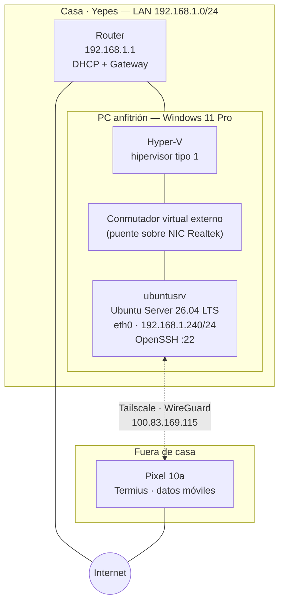

# Homelab — Fases 1 y 1b: Ubuntu Server con acceso remoto y servicios base

> Laboratorio de sistemas montado en casa para practicar administración de servidores
> Linux y Windows en un entorno propio, en paralelo al ciclo de ASIR.

**Fecha:** 24/10/2026
**Autor:** Martín De Prada — Soporte IT Deskside

---

## Objetivo

Montar un entorno de laboratorio donde poder administrar sistemas sin las limitaciones de
permisos de un puesto de soporte de nivel 1, y que además sirviera de apoyo práctico al
ciclo de ASIR.

El requisito que condicionó todo el diseño fue **el acceso remoto**: paso varios días a la
semana fuera de casa, así que un laboratorio al que solo pudiera entrar sentado delante del
PC habría quedado sin usar. Por eso la fase 1 no termina con el servidor instalado, sino con
el servidor accesible desde cualquier sitio.

---

## Arquitectura



Las líneas continuas son red física; la discontinua es el túnel cifrado de Tailscale. El
acceso desde fuera no pasa por el router: sale por el túnel, y por eso no hay ningún puerto
abierto hacia internet.

| Componente | Detalle |
|---|---|
| Anfitrión | Windows 11 Pro · Ryzen 7 5700X · 16 GB RAM · Gigabyte B550M K (BIOS F7) |
| Hipervisor | Hyper-V (tipo 1) |
| Máquina virtual | Generación 2 (UEFI) · 4 vCPU · 4 GB RAM fijos · disco VHDX de 60 GB |
| Sistema invitado | Ubuntu Server 26.04.1 LTS |
| Red virtual | Conmutador externo en puente sobre la NIC Realtek PCIe GbE |
| Direccionamiento | 192.168.1.240/24 · gw 192.168.1.1 · DNS 192.168.1.1 y 1.1.1.1 |
| Acceso local | OpenSSH, puerto 22 · autenticación por clave Ed25519 |
| Acceso remoto | Tailscale (WireGuard) · 100.83.169.115 |
| Cortafuegos | UFW · denegar entrante por defecto · apertura por servicio |
| Servidor web | Nginx · puerto 80, accesible solo por el túnel |
| Copias de seguridad | Script propio + cron diario, con rotación de 7 copias |
| Zona horaria | Europe/Madrid |

---

## Implantación

### 1. Preparación del anfitrión

Activación de la característica de Hyper-V desde PowerShell con privilegios de
administrador:

```powershell
Enable-WindowsOptionalFeature -Online -FeatureName Microsoft-Hyper-V -All
```

Hyper-V es un hipervisor de **tipo 1**: no se ejecuta sobre Windows como una aplicación más,
sino que se instala por debajo y toma el control directo del hardware. El propio Windows
pasa a ejecutarse como una partición privilegiada sobre él. Esa diferencia respecto a los
hipervisores de tipo 2, como VirtualBox, explica dos cosas que aparecen más adelante: que la
capa se cargue únicamente durante el arranque, y que los cambios requieran un apagado
completo y no un simple reinicio.

### 2. Red virtual

Creación de un conmutador virtual **externo** asociado al adaptador físico Realtek PCIe GbE,
con la opción de compartir el adaptador con el sistema anfitrión activada.

Hyper-V ofrece tres tipos de conmutador:

| Tipo | Alcance | Uso previsto |
|---|---|---|
| Externo | VM, anfitrión y red física | Esta fase: la VM necesita ser un equipo más de la LAN |
| Interno | VM y anfitrión | Laboratorios sin salida a internet |
| Privado | Solo entre VM | Fase 2: simular una red de empresa aislada |

Con el conmutador externo, la máquina virtual recibe su propia MAC (del rango `00:15:5D`,
reservado por Microsoft para Hyper-V) y el router la trata como un equipo físico más,
asignándole dirección por DHCP.

### 3. Creación e instalación de la máquina virtual

Máquina de **generación 2**, que emula firmware UEFI en lugar de una BIOS heredada. Esto
obliga a un ajuste que, de no hacerse, impide el arranque: por defecto el arranque seguro
solo confía en cargadores firmados por la autoridad certificadora de Windows, mientras que
el cargador de Ubuntu está firmado por la **Entidad de certificación UEFI de Microsoft**. Hay
que seleccionar esa plantilla en la configuración de seguridad de la VM.

Instalación de Ubuntu Server 26.04 LTS con las siguientes decisiones:

- **Idioma del sistema en inglés**, que es el estándar en entornos de servidor y el idioma en
  que están escritos los mensajes de error y la documentación.
- **Distribución de teclado en inglés de Estados Unidos**. Decisión forzada por un problema
  práctico documentado más abajo.
- **Instalación de OpenSSH server** durante el proceso, para disponer de acceso remoto desde
  el primer arranque.
- Sin paquetes snap adicionales.

### 4. Configuración de red estática

La dirección asignada por DHCP cambió en cada reinstalación y reinicio (`.40`, `.46`, `.33`),
lo que rompía el acceso por SSH. Se fijó mediante **netplan**, el sistema de configuración de
red declarativa de Ubuntu, que lee los ficheros `.yaml` de `/etc/netplan/` y genera a partir
de ellos la configuración efectiva.

Fichero `/etc/netplan/01-static.yaml`:

```yaml
network:
  version: 2
  ethernets:
    eth0:
      dhcp4: no
      addresses: [192.168.1.240/24]
      routes:
        - to: default
          via: 192.168.1.1
      nameservers:
        addresses: [192.168.1.1, 1.1.1.1]
```

```bash
sudo chmod 600 /etc/netplan/01-static.yaml
sudo netplan apply
```

Dos decisiones de diseño:

- **Se eligió una dirección alta (`.240`)** porque los routers domésticos reparten por DHCP un
  rango de direcciones bajas. Asignar manualmente una dirección dentro de ese rango puede
  provocar que el router se la entregue también a otro equipo, generando un conflicto de
  direcciones difícil de diagnosticar.
- **Permisos `600`** porque netplan advierte si los ficheros son legibles por otros usuarios:
  pueden contener credenciales de redes inalámbricas.

Verificación posterior siguiendo el orden estándar de diagnóstico de red:

```bash
ip a                  # ¿tengo dirección?
ping -c 4 1.1.1.1     # ¿tengo salida por IP? (valida la puerta de enlace)
ping -c 4 google.com  # ¿resuelvo nombres? (valida el DNS)
```

### 5. Acceso remoto con Tailscale

La dirección `192.168.1.240` es privada y solo existe dentro de la LAN. Desde el exterior
únicamente es visible la IP pública del router, que además descarta por defecto las
conexiones entrantes no solicitadas.

La alternativa habitual sería abrir el puerto 22 en el router y redirigirlo a la máquina,
pero eso expone un servicio SSH a internet y a los intentos de acceso automatizados que
recibe cualquier IP pública. En su lugar se optó por **Tailscale**, una VPN de malla basada
en WireGuard:

```bash
curl -fsSL https://tailscale.com/install.sh | sh
sudo tailscale up
tailscale ip -4
```

Cada dispositivo autenticado contra la misma cuenta recibe una dirección del rango `100.x`,
válida únicamente dentro de esa red privada. Las conexiones se establecen **salientes** desde
cada extremo hacia los servidores de coordinación, de modo que no hace falta abrir ningún
puerto ni exponer nada.

Se desactivó además la **caducidad de clave** del nodo. Por defecto las claves expiran a los
seis meses, lo cual tiene sentido en un portátil pero no en un servidor: el equipo quedaría
desconectado sin aviso.

Validación final: conexión por SSH desde un Pixel 10a con Termius, **con el WiFi desactivado
y saliendo por datos móviles**, para confirmar que el acceso funcionaba realmente a través
del túnel y no por estar en la misma red local.

### 6. Autenticación por clave SSH

Sustitución de la autenticación por contraseña por un par de claves asimétricas Ed25519.
Generación en el cliente Windows:

```powershell
ssh-keygen -t ed25519 -C "martin-homelab"
```

El proceso produce dos ficheros en `%USERPROFILE%\.ssh\`:

| Fichero | Función |
|---|---|
| `id_ed25519` | Clave **privada**, protegida con passphrase. No abandona el cliente |
| `id_ed25519.pub` | Clave **pública**. Es la que se instala en los servidores |

Instalación de la clave pública en el servidor, creando el directorio con los permisos que
exige OpenSSH:

```powershell
type $env:USERPROFILE\.ssh\id_ed25519.pub | ssh martin@192.168.1.240 `
  "mkdir -p ~/.ssh && chmod 700 ~/.ssh && cat >> ~/.ssh/authorized_keys && chmod 600 ~/.ssh/authorized_keys"
```

Los permisos no son opcionales: OpenSSH rechaza las claves si el directorio `~/.ssh` o el
fichero `authorized_keys` son accesibles por otros usuarios.

Para evitar introducir la passphrase en cada conexión se habilitó el agente SSH de Windows,
que mantiene la clave descifrada en memoria mientras dura la sesión:

```powershell
Get-Service ssh-agent | Set-Service -StartupType Automatic
Start-Service ssh-agent
ssh-add $env:USERPROFILE\.ssh\id_ed25519
```

**Decisión deliberada: no se deshabilitó aún la autenticación por contraseña.** El acceso
desde el móvil sigue utilizándola, de modo que cerrarla ahora dejaría ese cliente fuera. El
criterio aplicado es no retirar un método de acceso hasta haber verificado el nuevo **desde
todos los clientes** que vayan a usarlo. Es el punto exacto en el que es habitual perder el
acceso al propio servidor.

Pendiente para la siguiente sesión: generar un par de claves en el cliente móvil, instalar su
clave pública y entonces sí aplicar el endurecimiento del servicio:

```
PasswordAuthentication no
PubkeyAuthentication yes
```

### 7. Cortafuegos con UFW

Configuración de un cortafuegos con política restrictiva. El orden de las operaciones no es
indiferente: **las reglas se definen antes de activar el servicio**, porque activarlo primero
con la política de denegar por defecto cortaría la propia sesión SSH en uso.

```bash
sudo ufw default deny incoming
sudo ufw default allow outgoing
sudo ufw allow from 192.168.1.0/24 to any port 22 proto tcp
sudo ufw allow in on tailscale0 to any port 22 proto tcp
sudo ufw show added        # revisión previa
sudo ufw enable
```

**Decisión de diseño.** La primera versión de la regla del túnel era
`ufw allow in on tailscale0`, que confía en la interfaz completa. Se sustituyó por una regla
limitada al puerto 22. El criterio: la confianza se concede por servicio, no por interfaz.
El coste es que cada servicio nuevo necesita su propia regla explícita; el beneficio es que
nada queda expuesto por olvido.

Estado resultante:

| Destino | Acción | Origen |
|---|---|---|
| 22/tcp | ALLOW IN | 192.168.1.0/24 |
| 22/tcp on tailscale0 | ALLOW IN | Anywhere |

El sistema queda con **dos capas independientes**: el cortafuegos decide quién puede alcanzar
el puerto, y la autenticación por clave decide quién puede entrar. Un atacante dentro de la
red local seguiría necesitando una clave privada.

### 8. Servidor web Nginx

```bash
sudo apt install -y nginx
sudo ufw allow in on tailscale0 to any port 80 proto tcp
```

Nginx queda accesible **únicamente a través del túnel**, no desde la red local ni desde
internet. Se sustituyó la página por defecto por una propia en `/var/www/html/index.html`,
que tiene prioridad sobre `index.nginx-debian.html` según el orden definido en la directiva
`index` del bloque `server`.

Estructura de configuración, con el patrón habitual en Linux de *disponible* frente a
*habilitado*:

| Ruta | Contenido |
|---|---|
| `/etc/nginx/nginx.conf` | Configuración global |
| `/etc/nginx/sites-available/` | Definición de cada sitio, activo o no |
| `/etc/nginx/sites-enabled/` | Enlaces simbólicos a los sitios realmente servidos |
| `/var/www/html/` | Archivos servidos |

Para desactivar un sitio basta con eliminar su enlace simbólico, conservando la definición.

```bash
sudo nginx -t                  # validar antes de aplicar
sudo systemctl reload nginx    # recargar sin cortar conexiones activas
```

El acceso se realiza por HTTP, sin certificado. El tráfico no viaja en claro porque lo cifra
el túnel de Tailscale, pero el navegador no puede saberlo y lo marca como no seguro. Pendiente
de evaluar la emisión de certificados mediante Tailscale.

### 9. Copias de seguridad automáticas

Script en `/usr/local/bin/backup-config.sh` que empaqueta las configuraciones modificadas,
aplica rotación y deja registro en el sistema:

```bash
#!/bin/bash
set -euo pipefail

FECHA=$(date +%F_%H-%M)
DESTINO="/var/backups/config"
ARCHIVO="$DESTINO/config_$FECHA.tar.gz"

mkdir -p "$DESTINO"

tar -czf "$ARCHIVO" \
    /etc/netplan \
    /etc/ssh/sshd_config.d \
    /etc/ufw \
    /etc/nginx/sites-available \
    /var/www/html \
    2>/dev/null

# Rotación: conservar solo las 7 copias más recientes
ls -1t "$DESTINO"/config_*.tar.gz | tail -n +8 | xargs -r rm --

logger -t backup-config "Copia creada: $ARCHIVO"
```

Cuatro decisiones del script:

- **`set -euo pipefail`** aborta a la primera orden fallida, en lugar de continuar y generar
  una copia incompleta que parecería válida.
- **Rutas absolutas** en todo el script, porque cron se ejecuta con un entorno reducido y un
  `PATH` distinto del de una sesión interactiva.
- **Rotación** de 7 copias, para que el disco no crezca de forma indefinida.
- **`logger`** escribe en el journal del sistema: una tarea automática que no deja rastro no
  se puede auditar.

Programación con cron:

```
30 3 * * * /usr/local/bin/backup-config.sh
```

**Verificación.** No basta con que el script funcione al ejecutarlo manualmente: hay que
comprobar que cron lo lanza. Se programó temporalmente la tarea dos minutos por delante de la
hora del sistema y se contrastaron dos registros distintos:

```bash
journalctl -u cron --since "5 min ago"        # ¿se lanzó la tarea?
journalctl -t backup-config --since "5 min ago" # ¿hizo su trabajo?
```

Son dos preguntas independientes y se responden en logs independientes.

---

## Incidencias resueltas

### 1. La máquina virtual no arranca: «el hipervisor no está en ejecución»

**Síntoma.** Al iniciar la VM, Hyper-V devuelve el error *La máquina virtual no se pudo
iniciar porque el hipervisor no está en ejecución*, con sugerencias sobre la virtualización
asistida por hardware.

**Diagnóstico.** Se descartó primero la configuración del gestor de arranque:

```powershell
bcdedit /enum {current} | findstr -i hypervisor
```

El comando no devolvió ninguna línea, lo que indicaba que `hypervisorlaunchtype` no estaba
definido y por tanto conservaba su valor por defecto. Descartada esa vía, se comprobó el
estado real del procesador en el Administrador de tareas:

```
Virtualización:            Deshabilitado
Compatibilidad con Hyper-V: Sí
```

**Causa.** La virtualización asistida por hardware (**SVM Mode** en terminología AMD,
equivalente a VT-x en Intel) estaba deshabilitada en la BIOS. Sin esas extensiones del
procesador, el hipervisor no puede cargarse.

**Solución.** Activación de `SVM Mode` en la BIOS, en *Tweaker → Advanced CPU Settings*, y
**apagado completo del equipo**, no reinicio. El hipervisor se carga únicamente durante el
arranque, y un reinicio caliente conserva parte del estado anterior.

**Aprendizaje.** La virtualización no es solo software: depende de un juego de instrucciones
del procesador que permite ejecutar sistemas invitados a velocidad prácticamente nativa en
lugar de emularlos. Y la distinción entre reiniciar y apagar deja de ser una formalidad
cuando se toca una capa que solo se inicializa en el arranque.

---

### 2. «Permission denied» al conectar por SSH con la contraseña correcta

**Síntoma.** Rechazo reiterado de la autenticación pese a introducir la contraseña correcta.
En la salida del cliente aparecía:

```
martin_@192.168.1.40's password:
Permission denied, please try again.
```

**Causa.** Error de sintaxis en el comando. Se había escrito `ssh @martin 192.168.1.40` en
lugar de `ssh martin@192.168.1.40`. Al no encontrar un usuario válido antes de la arroba, el
cliente SSH toma por defecto **el nombre del usuario local del sistema**, en este caso el
usuario de Windows `Martin_`, que no existe en el servidor Ubuntu.

**Solución.** Sintaxis correcta `usuario@host`, o alternativamente el parámetro explícito:

```bash
ssh -l martin 192.168.1.240
```

**Aprendizaje.** El mensaje de error contenía la respuesta desde el primer intento: el prompt
mostraba `martin_@`, con un guion bajo que no correspondía a ningún usuario del servidor.
Leer con atención lo que devuelve la herramienta ahorra más tiempo que repetir el intento.

---

### 3. El servicio SSH figura como «inactive (dead)» pero funciona

**Síntoma.** La comprobación del servicio devolvía un estado aparentemente erróneo:

```
ssh.service - OpenBSD Secure Shell server
   Loaded: loaded (/usr/lib/systemd/system/ssh.service; disabled; preset: enabled)
   Active: inactive (dead)
TriggeredBy: ● ssh.socket
```

**Causa.** No era un fallo. Las versiones recientes de Ubuntu emplean **activación por
socket**: systemd mantiene un socket a la escucha en el puerto 22 y arranca el servicio solo
cuando llega una conexión entrante. El servicio permanece detenido mientras nadie se conecta.

**Solución.** Ninguna. La clave estaba en la línea `TriggeredBy: ● ssh.socket`, con el punto
en verde indicando que el socket sí estaba activo. La comprobación definitiva es verificar
qué proceso escucha en el puerto:

```bash
ss -tln | grep :22
```

**Aprendizaje.** Un servicio detenido no siempre significa un servicio caído. La activación
por socket ahorra recursos en servicios de uso intermitente, y comprobar el puerto es más
fiable que comprobar el estado del servicio.

---

### 4. Fichero bloqueado por un proceso huérfano de nano

**Síntoma.** Al reabrir un fichero en edición tras una desconexión:

```
File /etc/netplan/01-static.yaml is being edited by root
(with nano 8.7.1, PID 10214); open anyway?
```

**Causa.** La sesión SSH anterior se interrumpió sin cerrar nano correctamente. El editor
había creado un fichero oculto de bloqueo (`.01-static.yaml.swp`) para impedir ediciones
simultáneas, y el proceso quedó huérfano al perder su terminal.

**Solución.**

```bash
ps aux | grep nano          # localizar el proceso
sudo kill 10214             # terminarlo
sudo rm -f /etc/netplan/.01-static.yaml.swp
```

**Aprendizaje.** Primera aproximación práctica a la gestión de procesos en Linux: cada
programa en ejecución es un proceso identificado por un PID, `kill` envía una señal de
terminación, y los ficheros cuyo nombre empieza por punto están ocultos. También queda claro
por qué los editores crean ficheros de bloqueo y qué ocurre cuando una sesión remota se corta
de forma abrupta.

---

### 5. El portapapeles de Hyper-V escribe caracteres incorrectos

**Síntoma.** Al utilizar *Portapapeles → Escribir texto del portapapeles* en la consola de la
máquina virtual, el comando `ss -tln | grep :22` llegaba al servidor convertido en
`DXDDDmm`.

**Causa.** La función de portapapeles de Hyper-V no transfiere texto: **simula pulsaciones de
teclado**. Si la distribución configurada en el sistema invitado no coincide con la que asume
el anfitrión al enviarlas, los caracteres se descolocan. El problema afecta sobre todo a
símbolos como `|`, `@` o `\`.

**Solución.** Reinstalación del sistema invitado con distribución de teclado **inglés de
Estados Unidos**. Es además la configuración habitual en servidores de entorno profesional.
De forma complementaria, el problema deja de ser relevante una vez se administra por SSH: el
cliente de terminal gestiona el portapapeles de forma nativa.

**Aprendizaje.** La consola del hipervisor no es un terminal: es un teclado y una pantalla
virtuales. Esa diferencia explica por qué copiar y pegar se comporta de forma distinta según
se trabaje por consola o por SSH, y refuerza el criterio general de administrar los
servidores en remoto y reservar la consola para emergencias de red.

---

### 6. Pérdida de estado al revertir un punto de control automático

**Síntoma.** Pulsar por error *Revertir* en el Administrador de Hyper-V devolvió la máquina a
un estado anterior, perdiendo la configuración aplicada.

**Causa.** Hyper-V crea **puntos de control automáticos** al iniciar cada máquina virtual, y
la acción de revertir restaura el último sin solicitar confirmación adicional.

**Solución.** Desactivación de los puntos de control automáticos en *Configuración →
Puntos de control*, de modo que solo existan los creados de forma deliberada.

**Aprendizaje.** Los puntos de control son una de las herramientas más útiles de un
laboratorio: permiten crear un estado conocido antes de una modificación arriesgada y volver
a él en segundos. Pero conviene que sean explícitos. Un punto de control que no se sabe que
existe es un riesgo; uno creado a propósito antes de tocar algo es una red de seguridad.

---

### 7. Configuración aplicada pero sin efecto: precedencia de ficheros drop-in

**Síntoma.** Tras crear `/etc/ssh/sshd_config.d/99-hardening.conf` con
`PasswordAuthentication no` y reiniciar el servicio, el acceso por contraseña seguía
funcionando. El log lo demostraba sin lugar a dudas:

```
16:46:30  Starting ssh.service ...
16:48:02  Accepted password for martin from 100.111.120.125
```

Una autenticación por contraseña **posterior** al reinicio del servicio.

**Causa.** OpenSSH procesa los ficheros de `sshd_config.d/` en orden alfabético y aplica
**el primer valor que encuentra para cada directiva**, no el último. Un fichero generado por
cloud-init con un número de orden inferior fijaba `PasswordAuthentication yes`, de modo que el
fichero `99-` nunca llegaba a tener efecto.

**Solución.** Renombrar el fichero para que se procese antes, y verificar la configuración
efectiva en lugar de asumirla:

```bash
sudo mv /etc/ssh/sshd_config.d/99-hardening.conf /etc/ssh/sshd_config.d/01-hardening.conf
sudo sshd -t
sudo systemctl restart ssh
sudo sshd -T | grep -i passwordauthentication
```

`sshd -T` muestra la configuración que el servicio aplica realmente, resolviendo todos los
ficheros incluidos. Es la única fuente fiable.

**Problema asociado.** La prueba inicial desde el cliente móvil parecía correcta porque la
conexión no solicitaba contraseña. En realidad el cliente la tenía almacenada y la enviaba de
forma automática: no estaba utilizando la clave. El log del servidor fue lo que reveló la
diferencia entre `Accepted password` y `Accepted publickey`.

**Aprendizaje.** Dos cosas. Que el orden de los ficheros de configuración fragmentada importa,
y que no siempre es el último el que gana. Y que una prueba funcional puede dar un falso
positivo: la verificación válida no era "¿me deja entrar?" sino "¿con qué método me ha dejado
entrar?". Esa distinción solo la daba el registro del servidor.

---

### 8. Zona horaria del sistema frente a la hora local

**Síntoma.** Al programar una tarea de prueba para dos minutos más tarde según el reloj
propio, la tarea no se ejecutaba a la hora esperada.

**Causa.** El sistema estaba configurado en UTC, mientras que la hora de referencia utilizada
al redactar la expresión de cron era la local (CEST, UTC+2). Cron emplea siempre la hora del
sistema, de modo que existía un desfase de dos horas entre lo programado y lo esperado.

**Solución.** Verificar la hora real del sistema antes de programar cualquier tarea:

```bash
date
timedatectl
```

Y, en este caso, alinear el sistema con la zona horaria local:

```bash
sudo timedatectl set-timezone Europe/Madrid
```

**Consideración.** Mantener los servidores en UTC es la práctica habitual en entornos
profesionales por dos motivos: los registros de distintos sistemas resultan directamente
comparables, y se evita el problema del cambio de hora, en el que una tarea programada entre
las 2:00 y las 3:00 se ejecuta dos veces en octubre y ninguna en marzo. Se optó por la hora
local por comodidad en un entorno de laboratorio, situando la tarea a las 3:30 para dejarla
fuera de la franja conflictiva.

**Aprendizaje.** Una parte no pequeña de las incidencias del tipo «la tarea programada no se
ejecutó» no son fallos del programador de tareas, sino diferencias entre la hora del sistema y
la del operador.

---

## Comandos de referencia

```bash
# Diagnóstico de red, en este orden
ip a                              # ¿tengo dirección?
ping -c 4 1.1.1.1                 # ¿tengo salida por IP?
ping -c 4 google.com              # ¿resuelvo nombres?

# Servicios
systemctl status ssh
systemctl status ssh.socket
ss -tln | grep :22                # qué escucha en el puerto 22

# Configuración de red
sudo nano /etc/netplan/01-static.yaml
sudo chmod 600 /etc/netplan/01-static.yaml
sudo netplan apply

# Procesos
ps aux | grep <proceso>
sudo kill <PID>

# Actualización del sistema
sudo apt update && sudo apt upgrade -y

# Tailscale
sudo tailscale up
tailscale ip -4
tailscale status

# SSH: configuración efectiva y registro de accesos
sudo sshd -t                      # validar sintaxis
sudo sshd -T | grep -i password   # configuración realmente aplicada
sudo journalctl -u ssh | grep Accepted

# Cortafuegos
sudo ufw status verbose
sudo ufw show added
sudo ufw allow in on tailscale0 to any port <puerto> proto tcp

# Nginx
sudo nginx -t
sudo systemctl reload nginx

# Tareas programadas
date && timedatectl
sudo crontab -l
journalctl -u cron --since "10 min ago"
journalctl -t backup-config --since yesterday
```

```powershell
# Anfitrión Windows
Enable-WindowsOptionalFeature -Online -FeatureName Microsoft-Hyper-V -All
bcdedit /enum {current} | findstr -i hypervisor
ssh martin@192.168.1.240

# Claves SSH
ssh-keygen -t ed25519 -C "martin-homelab"
Get-Service ssh-agent | Set-Service -StartupType Automatic
Start-Service ssh-agent
ssh-add $env:USERPROFILE\.ssh\id_ed25519
```

---

## Relación con el ciclo de ASIR

| Contenido aplicado en el laboratorio | Unidad |
|---|---|
| Máquinas virtuales y arquitectura cliente-servidor | ISO · U1 |
| Gestores de arranque, UEFI y arranque seguro | ISO · U1 |
| Instalación de sistemas operativos y particionado | ISO · U1 |
| Usuarios, grupos locales y elevación de privilegios | ISO · U2 |
| Configuración del protocolo TCP/IP en un cliente de red | ISO · U2 |
| Resolución de nombres | ISO · U2 |
| Administración remota | ISO · U9 |
| Sistema de ficheros, usuarios y procesos en Linux | ISO · U10 |
| Seguridad de cuentas y autenticación | ISO · U2 |
| Copias de seguridad y aseguramiento de la información | ISO · U3 |
| Supervisión del sistema mediante registros | ISO · U7 |

---

## Siguientes fases

**Fase 1b — Consolidación del servidor Linux** *(completada)*
- [x] Autenticación por clave SSH desde el cliente Windows
- [x] Clave SSH en el cliente móvil
- [x] Deshabilitar la autenticación por contraseña
- [x] Cortafuegos UFW con política restrictiva
- [x] Servidor web Nginx accesible solo por el túnel
- [x] Copias de seguridad automáticas con cron, rotación y registro

**Pendiente de evaluar**
- [ ] HTTPS mediante certificados emitidos por Tailscale
- [ ] Monitorización de servicios

**Fase 2 — Windows Server**
Controlador de dominio con Active Directory, DNS, DHCP, unidades organizativas, directivas
de grupo y un cliente Windows unido al dominio.

**Fase 3 — Integración**
Unión del servidor Ubuntu al dominio de Active Directory, de forma que autentique contra los
mismos usuarios que los equipos Windows.

