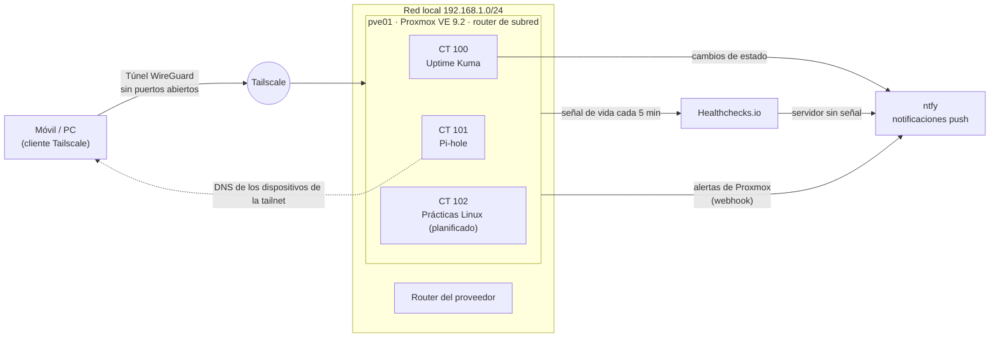

# Homelab — Práctica ASIR

[English](README.md) · **Español**

Laboratorio autoalojado para practicar administración de sistemas sin las limitaciones de permisos de un puesto de soporte de nivel 1: virtualización, servidores Linux y Windows, sistema de nombres de dominio (DNS), acceso remoto seguro, monitorización, alertas y copias de seguridad. Todo documentado, incluido lo que falló y por qué.

> Proyecto de Martín De Prada, estudiante de **ASIR** (Administración de Sistemas Informáticos en Red) y técnico de Soporte IT Deskside.

---

## Lo más destacado

- **Servidor dedicado con Proxmox VE 9.2** en un Dell OptiPlex 7020 de segunda mano (50 €), validado con Memtest86+ y SMART antes de usarlo.
- **Ningún puerto abierto en el router.** Todo el acceso remoto pasa por **Tailscale**, con el servidor como **router de subred** de toda la red local.
- **Defensa en profundidad en el hipervisor:** cuenta de uso diario y cuenta de emergencia separadas, **autenticación de dos factores (2FA) con TOTP** en ambas, y SSH solo con claves Ed25519.
- **Un vigilante que no vive dentro de lo que vigila:** Uptime Kuma revisa los servicios internos, y **Healthchecks.io** recibe una señal de vida cada 5 minutos y avisa si el servidor entero deja de responder.
- **Alertas al móvil** desde Proxmox, Uptime Kuma y Healthchecks mediante **ntfy** (el tema se guarda como secreto, nunca en archivos de configuración ni en este repositorio).
- **Copias de seguridad diarias con restauración probada:** una copia no cuenta como válida hasta que se ha restaurado.
- **Bloqueo de publicidad y malware** con Pi-hole para todos los dispositivos de la tailnet (~290 000 dominios bloqueados).
- **19 incidencias documentadas** con el formato síntoma → diagnóstico → causa → solución → aprendizaje.

---

## Arquitectura

---

## Hardware

| Componente | Servidor (pve01) |
|---|---|
| Modelo | Dell OptiPlex 7020 SFF |
| Procesador | Intel Core i5-4590 (4 núcleos / 4 hilos, Haswell) con Quick Sync |
| Memoria | 16 GB DDR3 → ampliación a 24 GB |
| Disco del sistema | SSD SATA de 240 GB (vigilado con `smartd`) |
| Almacenamiento previsto | Segundo SSD de 240 GB como LVM-Thin para las VM · HDD de 2 TB para copias y multimedia |
| Red | 1 GbE |

BIOS configurada para virtualización (VT-x, VT-d), arranque UEFI, SATA en AHCI y encendido automático tras un corte de luz.

---

## Servicios

| Servicio | Tipo | Función | Estado |
|---|---|---|---|
| Proxmox VE 9.2 | Anfitrión (Debian 13) | Hipervisor, copias de seguridad, notificaciones | ✅ |
| Tailscale | Anfitrión | Acceso remoto y router de subred, sin puertos expuestos | ✅ |
| Uptime Kuma 2 | LXC sin privilegios | Monitorización de servicios con avisos por ntfy | ✅ |
| Pi-hole v6 | LXC sin privilegios | Filtrado DNS para la tailnet (StevenBlack + Hagezi Pro) | ✅ |
| Healthchecks.io | Externo | Vigilancia de "señal de vida" del servidor completo | ✅ |
| Contenedor de prácticas Linux | LXC sin privilegios | Curso práctico de Linux con instantáneas | 🔜 |
| Nodo de control de Ansible | LXC | Gestión de configuración | 🔜 |
| Windows Server + Active Directory | VM | Controlador de dominio reconstruido desde cero | 🔜 |
| Rocky Linux | VM | Servidor de la familia Red Hat unido al dominio | 🔜 |

### Plan de direcciones IP

Las IP fijas quedan fuera del rango DHCP del router (de `.240` en adelante) y se registran en un único documento de inventario que se actualiza con cada cambio.

| IP | Equipo | Función |
|---|---|---|
| 192.168.1.242 | pve01 | Anfitrión Proxmox |
| 192.168.1.243 | kuma01 | Uptime Kuma |
| 192.168.1.244 | pihole01 | Pi-hole |
| 192.168.1.245 en adelante | — | Reservadas para los próximos servicios |

---

## Decisiones de seguridad

| Decisión | Motivo |
|---|---|
| Ninguna redirección de puertos en el router | Nada expuesto a internet; Tailscale cubre todo el acceso remoto |
| Cuentas separadas (`Administrator` para el día a día, `root` solo para emergencias), ambas con 2FA TOTP y códigos de recuperación | Mínimo privilegio y ningún punto único de compromiso |
| SSH con claves Ed25519; las claves privadas nunca se copian entre equipos | Cada cliente tiene su propia clave revocable |
| El anfitrión usa un DNS público, nunca un DNS que él mismo aloja | La infraestructura base no puede depender de servicios que corren encima de ella |
| Pi-hole solo atiende a la tailnet, no a toda la casa | Los experimentos no deben romper la red de otras personas |
| Sin cambios de red ni de cortafuegos en remoto sin una vía de acceso de emergencia | Evitar quedarse fuera hasta volver a casa |
| Los secretos (contraseñas, tema de ntfy, URL de ping) solo están en un gestor de contraseñas | Nada sensible en la documentación ni en este repositorio |

---

## Monitorización y alertas

- **Uptime Kuma** vigila la web de Proxmox (HTTPS), el ping del anfitrión, la salida a internet y la resolución DNS. Avisa en los **cambios de estado** por ntfy con prioridad alta.
- **Las notificaciones de Proxmox** (resultado de copias, salud de discos con `smartd`, actualizaciones) van al correo y a ntfy mediante un destino webhook cuyo tema está guardado como *secret* de Proxmox.
- **Healthchecks.io** recibe una señal de vida por cron cada 5 minutos. Si falla el servidor, su red o la luz, el aviso lo da el servicio externo, porque el vigilante no puede vivir dentro de lo que vigila.

## Copias de seguridad

- Tarea diaria a las 03:30 para todos los contenedores y VM, en modo snapshot y con compresión ZSTD.
- Retención: 7 diarias + 2 semanales.
- **Restauración probada** de principio a fin.
- Siguiente paso: llevar las copias a un disco dedicado de 2 TB, porque una copia en el mismo SSD que el sistema no es una copia de verdad.

---

## Registro de incidencias (selección)

Cada problema se documenta con un formato fijo. Algunos ejemplos:

| Nº | Síntoma | Causa raíz | Aprendizaje |
|---|---|---|---|
| 13 | `Could not resolve host` en el servidor | El router del proveedor no responde como DNS; solo reparte por DHCP los DNS del operador, por eso fallaba únicamente el equipo con IP fija | "No hay internet" muchas veces significa "no hay DNS". Un "sistema actualizado" anterior era falso porque se comprobó con el DNS roto |
| 7 | El endurecimiento de SSH no surtía efecto | En `sshd_config.d/` gana el **primer** archivo que define un valor, y el de cloud-init iba antes que el mío | Verificar la configuración efectiva con `sshd -T` y los registros, no el archivo escrito |
| 3 | SSH aparece como `inactive (dead)` pero funciona | Activación por socket de systemd | Comprobar los puertos en escucha con `ss -tln`, no solo el estado del servicio |
| 17 | El webhook de Proxmox devolvía HTTP 404 | El secreto con el tema de ntfy se guardó mal | Probar cada vía de alerta con un evento real |
| 18 | Error de permisos de NTP en Pi-hole | Un LXC sin privilegios comparte con el anfitrión el núcleo **y el reloj**, así que no puede cambiar la hora | Desactivar la función en el contenedor; la hora la gestiona el anfitrión |

### Método de diagnóstico

1. **Leer la salida literal, no la esperada.** Un "Listo" o "actualizado" no prueba nada.
2. **Escalera de red, siempre en orden:** dirección IP → puerta de enlace → internet por IP → resolución de nombres.
3. **Verificar la configuración efectiva**, no la escrita (`sshd -T`, `nginx -t`, `ufw status verbose`, `gpresult /r`).
4. **Los registros responden lo que la prueba funcional no:** no "¿funciona?", sino "¿por qué camino ha funcionado?".

---

## Historia del proyecto

| Fase | Fecha | Alcance |
|---|---|---|
| 1 | Oct 2026 | Ubuntu Server en Hyper-V, IP fija con netplan, acceso remoto con Tailscale |
| 1b | Oct 2026 | Endurecimiento: claves SSH, UFW por servicio, Nginx accesible solo por el túnel, copias de configuración con cron y rotación |
| 2 | Oct 2026 | Windows Server y Active Directory (`lab.internal`): unidades organizativas propias, modelo AGDLP, cuentas separadas de administrador y usuario, directivas de grupo (GPO) de prueba |
| 3 | Oct 2026 → | Servidor dedicado con Proxmox: todo lo descrito arriba |

Lo aprendido en la fase 2 (registros DNS que quedan apuntando a una IP antigua, renombrar un controlador de dominio ya promovido) es la razón de **reconstruir el controlador de dominio desde cero en Proxmox**, en el orden correcto, en lugar de migrarlo.

---

## Próximos pasos

- [ ] Sesión de hardware: memoria a 24 GB, segundo SSD como LVM-Thin para las VM, HDD de 2 TB para copias (con prueba SMART larga)
- [ ] Curso práctico de Linux en 12 clases dentro de un contenedor protegido con instantáneas
- [ ] **Ansible:** inventario, comandos *ad hoc*, playbook de actualizaciones, endurecimiento SSH con plantillas y *handlers*, roles y Vault, Windows por WinRM
- [ ] Active Directory reconstruido en Proxmox (controladores VirtIO, valorando Server Core) y un cliente Windows 11
- [ ] Servidor Rocky Linux unido al dominio (dnf, SELinux, firewalld)
- [ ] Pi-hole: registros locales `*.home.arpa` y reenvío condicional de `lab.internal` al controlador de dominio
- [ ] Un servicio cada vez, revisando la memoria tras cada uno: Nginx Proxy Manager → GLPI → Authentik → Grafana + Prometheus → Jellyfin → Wazuh → Proxmox Backup Server
- [ ] IA local: Ollama en la gráfica del PC y un analizador de registros que se ejecuta en el servidor

---

*Todas las IP que aparecen son privadas (RFC 1918). En este repositorio no se publican contraseñas, claves, el nombre de la tailnet ni temas de notificaciones.*

