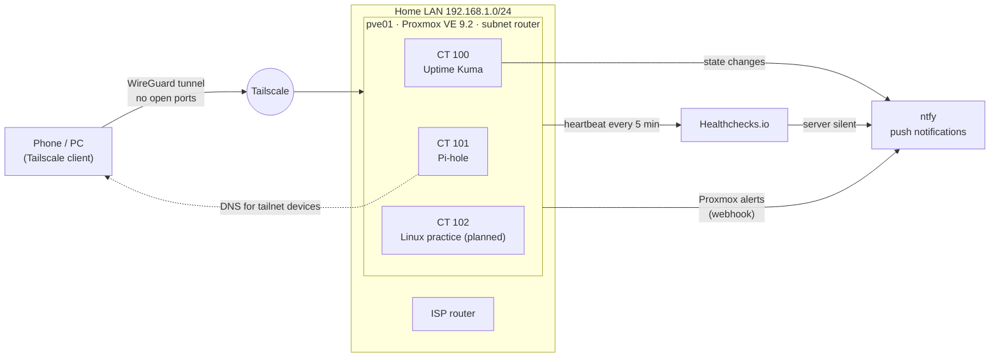

# Homelab — ASIR Practice

**English** · [Español](README.es.md)

A self-hosted lab built to practice systems administration outside the permission limits of a level 1 support job: virtualization, Linux and Windows servers, DNS, secure remote access, monitoring, alerting and backups — all documented, including what broke and why.

> Built and maintained by Martín De Prada while studying **ASIR** (Network Systems Administration, Spain) and working in IT Deskside Support.

---

## Highlights

- **Dedicated Proxmox VE 9.2 server** on a second-hand Dell OptiPlex 7020 (€50), validated with Memtest86+ and SMART before use.
- **Zero ports open on the router.** All remote access goes through **Tailscale**, with the server acting as a **subnet router** for the whole LAN.
- **Defense in depth on the hypervisor:** separate daily-use and emergency accounts, **TOTP two-factor authentication** on both, SSH with Ed25519 keys only.
- **Monitoring that does not live inside what it monitors:** Uptime Kuma checks internal services, while **Healthchecks.io** receives a heartbeat every 5 minutes and alerts if the whole server goes silent.
- **Push alerts** from Proxmox, Uptime Kuma and Healthchecks to the phone via **ntfy** (topic stored as a secret, never in config files or this repo).
- **Daily backups with a tested restore** — a backup is not considered valid until it has been restored.
- **Network-wide ad and malware blocking** with Pi-hole for every device on the tailnet (~290,000 blocked domains).
- **19 incidents documented** in a symptom → diagnosis → cause → fix → lesson format.

---

## Architecture

---

## Hardware

| Component | Server (pve01) |
|---|---|
| Model | Dell OptiPlex 7020 SFF |
| CPU | Intel Core i5-4590 (4C/4T, Haswell) with Quick Sync |
| RAM | 16 GB DDR3 → upgrading to 24 GB |
| System disk | 240 GB SATA SSD (SMART monitored with `smartd`) |
| Planned storage | Second 240 GB SSD as LVM-Thin pool for VMs · 2 TB HDD for backups and media |
| Network | 1 GbE |

BIOS configured for virtualization (VT-x, VT-d), UEFI boot, AHCI, and automatic power-on after an outage.

---

## Services

| Service | Type | Purpose | Status |
|---|---|---|---|
| Proxmox VE 9.2 | Host (Debian 13) | Hypervisor, backups, notifications | ✅ |
| Tailscale | Host | Remote access and subnet routing, no exposed ports | ✅ |
| Uptime Kuma 2 | Unprivileged LXC | Service monitoring with ntfy alerts | ✅ |
| Pi-hole v6 | Unprivileged LXC | DNS filtering for tailnet devices (StevenBlack + Hagezi Pro) | ✅ |
| Healthchecks.io | External | Dead man's switch for the whole server | ✅ |
| Linux practice container | Unprivileged LXC | Hands-on Linux course with snapshots | 🔜 |
| Ansible control node | LXC | Configuration management | 🔜 |
| Windows Server + Active Directory | VM | Domain controller rebuilt from scratch | 🔜 |
| Rocky Linux | VM | RHEL-family server joined to the domain | 🔜 |

### IP plan

Static addresses live outside the router's DHCP range (`.240` and up) and are tracked in a single inventory document, updated with every change.

| IP | Host | Role |
|---|---|---|
| 192.168.1.242 | pve01 | Proxmox host |
| 192.168.1.243 | kuma01 | Uptime Kuma |
| 192.168.1.244 | pihole01 | Pi-hole |
| 192.168.1.245+ | — | Reserved for upcoming services |

---

## Security decisions

| Decision | Reason |
|---|---|
| No port forwarding on the router | Nothing exposed to the internet; Tailscale handles all remote access |
| Separate accounts (`Administrator` for daily use, `root` only for emergencies), both with TOTP 2FA and recovery codes | Least privilege and no single point of compromise |
| SSH with Ed25519 keys; private keys never copied between devices | Each client has its own revocable key |
| The host uses a public resolver, never a DNS server it hosts itself | Base infrastructure must not depend on services running on top of it |
| Pi-hole serves only tailnet devices, not the whole household | Experiments must not break the network for other people |
| No network or firewall changes while working remotely without an emergency access path | Avoid locking myself out until I get home |
| Secrets (passwords, ntfy topic, ping URLs) live only in a password manager | Nothing sensitive in documentation or in this repository |

---

## Monitoring and alerting

- **Uptime Kuma** monitors the Proxmox web UI (HTTPS), host ping, internet reachability and DNS resolution. Alerts fire on **state changes** through ntfy with high priority.
- **Proxmox notifications** (backup results, disk health from `smartd`, updates) go to email and to ntfy through a webhook target whose topic is stored as a Proxmox *secret*.
- **Healthchecks.io** receives a cron heartbeat every 5 minutes. If the server, its network or its power fails, the external service raises the alert — because a watcher cannot live inside what it watches.

## Backups

- Daily job at 03:30 covering every container and VM, snapshot mode, ZSTD compression.
- Retention: 7 daily + 2 weekly.
- **Restore tested** end to end.
- Next step: move backups to a dedicated 2 TB disk, since backups on the same SSD as the system are not real backups.

---

## Troubleshooting log (selection)

Every problem is written up in a fixed format. A few examples:

| # | Symptom | Root cause | Lesson |
|---|---|---|---|
| 13 | `Could not resolve host` on the server | The ISP router does not answer DNS queries; it only hands out its provider's resolvers via DHCP, so only the static-IP host failed | "No internet" often means "no DNS". An earlier "system up to date" was false because it was checked with broken DNS |
| 7 | SSH hardening had no effect | In `sshd_config.d/` the **first** file to set a value wins, and cloud-init's file sorted before mine | Verify the effective config with `sshd -T` and the logs, not the file you wrote |
| 3 | SSH shown as `inactive (dead)` but working | systemd socket activation | Check listening ports with `ss -tln`, not just service status |
| 17 | Proxmox webhook returned HTTP 404 | The secret holding the ntfy topic was saved incorrectly | Test every alert path with a real event |
| 18 | NTP permission error in Pi-hole | An unprivileged LXC shares the host's kernel **and clock**, so it cannot set the time | Disable the feature inside the container; time sync belongs to the host |

### Diagnostic method

1. **Read the literal output, not the expected one.** "Done" or "up to date" proves nothing.
2. **Network ladder, always in order:** IP address → gateway → internet by IP → name resolution.
3. **Verify the effective configuration**, not the written one (`sshd -T`, `nginx -t`, `ufw status verbose`, `gpresult /r`).
4. **Logs answer what a functional test cannot:** not "does it work?" but "which path made it work?".

---

## Project history

| Phase | Date | Scope |
|---|---|---|
| 1 | Oct 2026 | Ubuntu Server on Hyper-V, static IP with netplan, remote access with Tailscale |
| 1b | Oct 2026 | Hardening: SSH keys, UFW per service, Nginx reachable only through the tunnel, config backups with cron and rotation |
| 2 | Oct 2026 | Windows Server and Active Directory (`lab.internal`): custom OUs, AGDLP model, admin/user account split, test GPOs |
| 3 | Oct 2026 → | Dedicated Proxmox server: everything described above |

Phase 2 lessons (DNS records left behind after an IP change, renaming a promoted DC) are the reason the domain controller will be **rebuilt from scratch on Proxmox** in the correct order instead of migrated.

---

## Roadmap

- [ ] Hardware session: RAM to 24 GB, second SSD as LVM-Thin for VMs, 2 TB HDD for backups (with extended SMART test)
- [ ] 12-lesson hands-on Linux course in a snapshot-protected container
- [ ] **Ansible:** inventory, ad-hoc commands, update playbook, SSH hardening with templates and handlers, roles and Vault, Windows via WinRM
- [ ] Active Directory rebuilt on Proxmox (VirtIO drivers, evaluating Server Core) plus a Windows 11 client
- [ ] Rocky Linux server joined to the domain (dnf, SELinux, firewalld)
- [ ] Pi-hole: local `*.home.arpa` records and conditional forwarding of `lab.internal` to the DC
- [ ] One service at a time, checking memory after each: Nginx Proxy Manager → GLPI → Authentik → Grafana + Prometheus → Jellyfin → Wazuh → Proxmox Backup Server
- [ ] Local AI: Ollama on the desktop GPU plus a log analyzer running on the server

---

*All IP addresses shown are private (RFC 1918). No credentials, keys, tailnet names or notification topics are published in this repository.*
